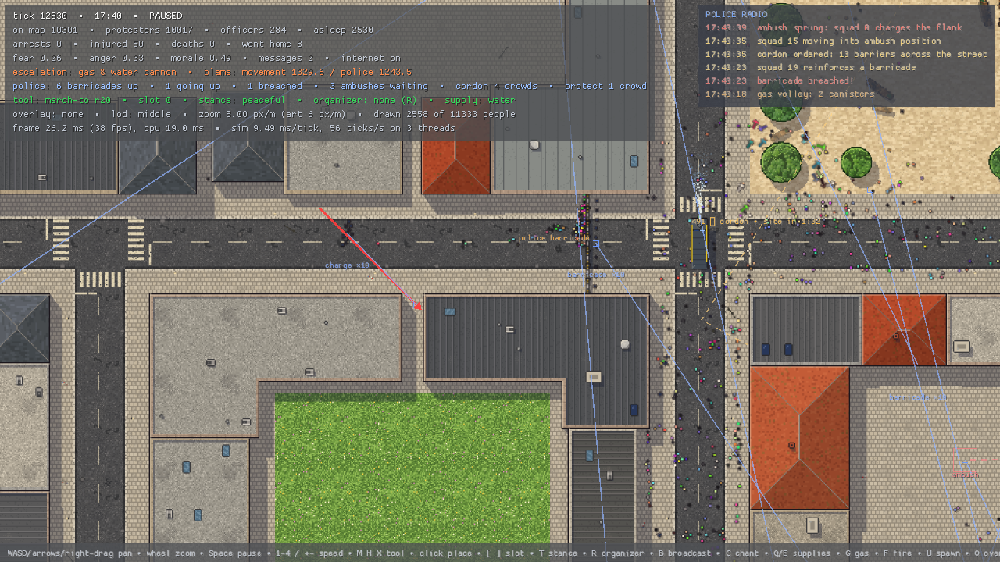

# Riotter

A real-time riot simulation: thousands of autonomous people and a police
force on a city map of up to 8 × 8 km. You never command anyone. You
influence the crowd through organizers, objectives, stances, chants and
supply drops, and every person decides what to do with that. The police
think for themselves: they read where each crowd is going, barricade its
route before it gets there, hide squads around corners to charge its flank,
kettle, warn, gas and arrest, and learn from what worked. The full design is
in [DESIGN.md](DESIGN.md).


It is drawn as top-down pixel art: textured streets, roofs and parks, people,
vehicles and props as sprites, all generated at start-up (see
[Graphics](#graphics)).

## Quick start

Rust 1.99 or newer. Release builds target x86-64-v3 (AVX2), see
[Build configuration](#build-configuration).

```sh
# Watch the standard riot (10,000 people, 30 police squads, 20 minutes).
cargo app --scenario data/scenarios/standard_riot.ron

# Or a generated district: --people, --squads, --size, --seed.
cargo app --people 5000 --squads 10

# Headless: progress, per-phase benchmark, auto-resolve, the police's view.
cargo headless run --scenario data/scenarios/small_protest.ron
cargo headless bench --scenario data/scenarios/standard_riot.ron --warmup 4800
cargo headless resolve --scenario data/scenarios/standard_riot.ron
cargo headless police --scenario data/scenarios/standard_riot.ron --every 1200
```

`cargo app` and `cargo headless` are aliases for
`cargo run --release -p riot_app --` and `cargo run --release -p riot_headless --`.
`--help` lists every option.

## Playing

The camera looks straight down. Everything you do becomes a command the
crowd interprets; none of it is an order.

| Input | What it does |
|---|---|
| WASD / arrows, right or middle drag | pan (Shift: faster) |
| mouse wheel | zoom (Shift + wheel: tool radius) |
| Home | fit the map |
| Space, `.` | pause, step one tick |
| 1 2 3 4, `+` `-` | game speed 1×, 2×, 4×, 8× |
| M, H, X then left click | place a March to, Hold or Disperse objective in the current slot |
| `[` `]`, Backspace | choose an objective slot (0–15), clear it |
| T | cycle the stance attached to messages: peaceful, defensive, confrontational |
| R, B, C | select the nearest organizer, have them broadcast the plan, chant |
| Q, E | choose a supply (water, medic, shields, barricade material), drop it |
| O, L, V, Tab, P | overlay (density, fear, anger, threat, gas, messages, cameras, pressure), level of detail, roofs, markers and the police plan, phase timings |
| K, J, N | pixel art on/off, pixel size 1×/2×, time-of-day light |
| G, F, U, Y, PageUp | debug: gas, fire, spawn people, stamp threat, raise escalation |
| F1, Esc | help, quit |

The HUD's **police radio** (top right) reports what the police commander
does as it does it: cordons ordered and barricades up, breaches, ambushes set
and sprung, kettles, dispersal orders, gas volleys, relieved and broken lines.
With markers on (Tab), each crowd the police track shows its predicted route
and the operation against it, barricades show as ordered, up or breached, and
squads waiting in ambush as red diamonds around their corners.

`--tunables data/tunables.ron` reloads the tunables file while the game runs.
`--pixel 2` doubles the size of the pixels; `--pixel 0` draws without pixel art.
`--ticks N --screenshot out.png` simulates N ticks, renders and saves a PNG
without a display (Xvfb works), which is how the screenshots in
`docs/screenshots/` were made.

## Workspace

| Crate | What it is |
|---|---|
| `riot_core` | lane storage (`F32x8`, 512-agent chunks), counter-based RNG streams, stable bucket and radix sorts, spatial hash, sparse sets, math |
| `riot_team` | the fork-join thread team the tick runs on: workers spin between parallel loops instead of sleeping, and each chunk index runs exactly once |
| `riot_sim` | the simulation: headless, deterministic, fixed 20 Hz tick, no allocation after warm-up. `RiotSetup` goes in, `RiotOutcome` comes out |
| `riot_data` | Tiled JSON maps, the procedural city generator, RON scenarios and tunables |
| `riot_headless` | batch runs, benchmarks, determinism and allocation checks, auto-resolve, PNG snapshots, map generation |
| `riot_render` | procedural pixel art (people, materials, decals, props, vehicles) and the renderer: a pixel buffer at the art's density, instanced layered sprites from simulation snapshots, textured map meshes, shadows, effects |
| `riot_app` | the window: the simulation on its own thread, input, HUD, hot reload |

`data/` holds the maps, the scenarios and `tunables.ron`. See
[data/maps/README.md](data/maps/README.md) for drawing maps in Tiled and
[data/scenarios/README.md](data/scenarios/README.md) for writing scenarios.

| Scenario | Map | People | Notes |
|---|---|---|---|
| `small_protest` | 1 km district | 2,000 | a peaceful rally, batons at most |
| `standard_riot` | 1 km district | 10,000 | the benchmark; the march on parliament usually turns violent |
| `mass_demonstration` | 8 km city | 50,000 | the stretch target |
| `city_day` | 8 km city | 30,000 | 14 hours, internet shutdown at nine |

## Graphics

Everything on screen is pixel art painted by code when the game starts; there
are no image files. Shapes are described in metres and rasterized with hard
edges, banded shading and one-pixel outlines at four **art levels**: 48, 24,
12 and 6 pixels per metre. The world is drawn into an offscreen buffer at the
densest level that fits the zoom, with the camera snapped to whole pixels, so
every texture and sprite is sampled texel for pixel; a sharp-bilinear filter
scales the buffer to the screen, keeping pixels square at any zoom and
scrolling smooth. Each level is its own pixel art, not a blurred copy of the
one above it.

- **People**: layered paper-doll sprites (body, accessory, head, held item)
  in palette weights, so a few sheets give thousands of different people;
  they rotate freely with their heading and cast a shadow.
- **Map**: tileable materials (asphalt with cracks, pavement slabs, granite
  kerbs, sandstone setts, grass, water, clay tiles, slate, gravel, bitumen,
  corrugated metal, foliage) on meshes built from the map: kerbs and gutters
  along every road, centre and lane lines, zebra crossings, manholes, drains,
  stains, hipped roofs lit by facet, flat roofs behind parapets with air
  conditioning, vents, skylights, solar panels, tanks and stair huts, tree
  canopies and arcades.
- **Props and vehicles**: parked cars in eight paints, burnt out or
  overturned; bins, benches, crowd barriers, barricades, supply pallets;
  police vans and ambulances with Battenburg markings and flashing light
  bars, water cannon with a turret.
- **Light**: shadows swept from buildings, trees, props, vehicles and people
  towards the south-east, depth-tested so overlapping shadows never darken
  twice; dithered gas and smoke; pixel flames and spray; a colour grade for
  the time of day, and at night pools of light from street lamps, fires,
  molotovs and police light bars.

## The police



The police director clusters the crowd every second; above it a commander
(`riot_sim::tactics`, DESIGN §14.1) works out what to do about each crowd:

- **It reads the crowd.** Crowds are tracked from one replan to the next.
  Where one is going comes from the plan its people follow; how it will get
  there comes from its own flow-field corridor, so the police predict the
  exact route, street by street.
- **It barricades the route.** A crowd heading for the government quarter is
  met at the narrowest street on its route that a squad can reach first. The
  officers set steel barriers across it, wall to wall, and hold behind them.
  Routes price police barriers almost like walls, so the crowd looks for
  another way round, and the commander cordons that street too. Crowds push
  barriers over, faster when angry and slower when officers brace them; a
  breach sends the police back to the next street toward the site.
- **It sets ambushes.** A riot squad waits crouched in a side street short of
  a barricade, invisible to a crowd that only perceives what it faces. When
  the crowd fights at the barricade, the squad charges out across the street,
  cuts the crowd in two and sweeps the rear part back.
- **It picks its operations.** Watch, escort a march, cordon, protect the
  site, kettle (opening a filter gate once the crowd calms down), or disperse:
  a loudspeaker warning, then gas thrown upwind of the violent core, never
  into a packed mass or a kettle, then water cannon and advancing lines.
- **It learns.** Breached barricades get more squads, ambushes are used more
  or less as they work, worn-out lines are relieved by fresh squads, and
  escalation weighs violence against how close crowds are to the site and
  how the footage looks.

`cargo headless police` prints the commander's crowds, cordons, squads and
radio calls as a riot runs.

## Pathfinding

People route on flow fields built in tiles along a corridor of 128 m regions
(DESIGN §9), so a route across an 8 km city never searches the whole map.
Routes are **any-angle**: the tile search is Theta\*-style, each tile heading
straight for an anchor it can see (the goal, or the open tile where the route
next turns), and each 8 m flow tile is solved with the Fast Marching Method,
so people walk straight across squares and round corners closely instead of
following a grid's staircase. Crowding, gas and fire raise the cost of the
ground they cover, so routes bend around crushes and clouds. While a flow
tile is still being built, people head for their tile's anchor instead of
walking at a wall.

## Tests and checks

```sh
cargo test --release --workspace
```

Behaviour, determinism and allocation tests simulate thousands of people for
minutes of game time, so run them optimized. Among them:

- **Determinism**: identical state hashes on every tick at 1, 2, 3 and 4
  threads, on a violent scenario and on a march
  (`crates/riot_sim/tests/determinism.rs`).
- **Zero allocation**: a counting allocator sees no heap allocation in 800
  ticks after warm-up (`crates/riot_sim/tests/no_alloc.rs`).
- **Behaviour** (`crates/riot_sim/tests/behaviour.rs`): a packed crowd barely
  overlaps, gas clears a crowd, calling everyone to one spot crushes, a
  broadcast spreads, a kettle closes, bottles never pass a shield line,
  shields cover officers from the front, and a violent riot is not a
  massacre.
- **Police** (`crates/riot_sim/tests/police.rs`): the police barricade a
  crowd's route before it arrives and the crowd goes round the other way; an
  ambush waits unseen in a side street and charges when the crowd fights at
  the barricade.
- **Data**: every scenario loads and runs, and `data/tunables.ron` lists
  every tunable with its default.

The headless runner adds `determinism` (any scenario, any thread counts),
`alloc` (with `--trace` to print where an allocation happens) and `hashes`,
which prints one hash per tick so two builds can be compared with `diff`.

CI (`.github/workflows/ci.yml`) runs fmt, clippy with warnings as errors, the
release tests, the headless determinism and allocation checks, a comparison
of x86-64-v3 and baseline x86-64 hashes, a build on the minimum Rust version,
and a benchmark report in the job summary.

## Build configuration

`.cargo/config.toml` builds for x86-64-v3 (AVX2, FMA, BMI2). A baseline
build is `RUSTFLAGS="-C target-cpu=x86-64" cargo build --release`; both give
bit-identical simulations. Profiles: `release` (fat LTO, line tables for
profilers), `profiling` (full debug info) and `dist` (stripped).

## Performance

DESIGN §3 targets 10,000 agents in 3 ms per 20 Hz tick on a 4-core desktop,
on any map size. Measured on a 4-vCPU cloud VM (p50 over 400 ticks after
warm-up; the standard riot is the median of three runs, since run-to-run
noise there is about ±10%):

| | Target | Measured |
|---|---|---|
| Small protest, 2,000 agents | ≤ 0.7 ms / tick | 0.95 ms |
| Standard riot, 10,309 agents | ≤ 3.0 ms / tick | 3.65 ms |
| Same crowd on an 8 km vs a 512 m map | within 5% | +0.9% |
| Auto-resolve, 10-minute riot | ≤ 40 s | 37.0 s |
| Auto-resolve, 1 simulated hour | ≤ 2 min | 5 min 41 s |

At 10k, spatial, think, messages, bodies, interactions, the director and
accounting are within their §3.1 phase budgets; fields (0.7 ms against 0.3)
and steering (0.8 ms against 0.26) are not. Fields cost follows the active
field chunks more than the head count, which is why the small protest, spread
over the district, misses its target. An hour of riot stays too busy for
sleeping (§7.6) to help much. The tick runs on `riot_team`, a spinning
fork-join team: on this VM rayon's wake-ups after serial stretches cost
about 0.1 ms per parallel loop, which had made the tick 5.6 ms.

`cargo headless bench` prints p50 and p99 per phase against the budget
table (`--csv` writes them out, `--budget` fails when a phase is more than
10% over); `cargo headless mapsize` compares map sizes.

## License

MIT or Apache-2.0, at your option.
