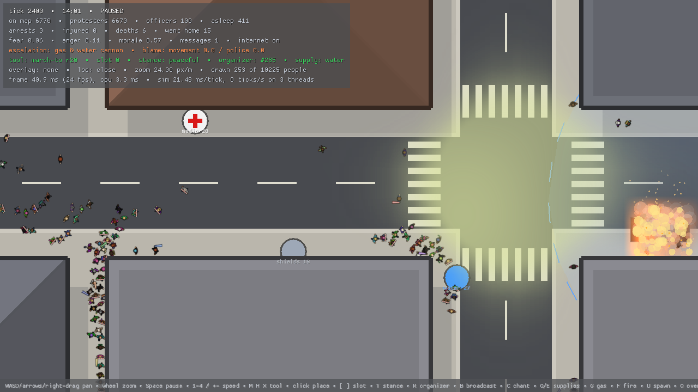

# Riotter

A real-time riot simulation: thousands of autonomous people and a police
force on a city map of up to 8 × 8 km. You never command anyone. You
influence the crowd through organizers, objectives, stances, chants and
supply drops, and every person decides what to do with that. The full design
is in [DESIGN.md](DESIGN.md).



## Quick start

Rust 1.88 or newer. Release builds target x86-64-v3 (AVX2), see
[Build configuration](#build-configuration).

```sh
# Watch the standard riot (10,000 people, 30 police squads, 20 minutes).
cargo app --scenario data/scenarios/standard_riot.ron

# Or a generated district: --people, --squads, --size, --seed.
cargo app --people 5000 --squads 10

# Headless: progress, per-phase benchmark, auto-resolve.
cargo headless run --scenario data/scenarios/small_protest.ron
cargo headless bench --scenario data/scenarios/standard_riot.ron --warmup 4800
cargo headless resolve --scenario data/scenarios/standard_riot.ron
```

`cargo app` and `cargo headless` are aliases for
`cargo run --release -p riot_app --` and `cargo run --release -p riot_headless --`.
`--help` lists every option.

## Playing

The camera looks straight down. Everything you do becomes a command the
crowd interprets; none of it is an order.

| Input | What it does |
|---|---|
| WASD / arrows, right or middle drag | pan (Shift: faster) |
| mouse wheel | zoom (Shift + wheel: tool radius) |
| Home | fit the map |
| Space, `.` | pause, step one tick |
| 1 2 3 4, `+` `-` | game speed 1×, 2×, 4×, 8× |
| M, H, X then left click | place a March to, Hold or Disperse objective in the current slot |
| `[` `]`, Backspace | choose an objective slot (0–15), clear it |
| T | cycle the stance attached to messages: peaceful, defensive, confrontational |
| R, B, C | select the nearest organizer, have them broadcast the plan, chant |
| Q, E | choose a supply (water, medic, shields, barricade material), drop it |
| O, L, V, Tab, P | overlay (density, fear, anger, threat, gas, messages, cameras, pressure), level of detail, roofs, markers, phase timings |
| G, F, U, Y, PageUp | debug: gas, fire, spawn people, stamp threat, raise escalation |
| F1, Esc | help, quit |

`--tunables data/tunables.ron` reloads the tunables file while the game runs.
`--ticks N --screenshot out.png` simulates N ticks, renders and saves a PNG
without a display (Xvfb works), which is how the screenshots in
`docs/screenshots/` were made.

## Workspace

| Crate | What it is |
|---|---|
| `riot_core` | lane storage (`F32x8`, 512-agent chunks), counter-based RNG streams, stable bucket and radix sorts, spatial hash, sparse sets, math |
| `riot_sim` | the simulation: headless, deterministic, fixed 20 Hz tick, no allocation after warm-up. `RiotSetup` goes in, `RiotOutcome` comes out |
| `riot_data` | Tiled JSON maps, the procedural city generator, RON scenarios and tunables |
| `riot_headless` | batch runs, benchmarks, determinism and allocation checks, auto-resolve, PNG snapshots, map generation |
| `riot_render` | instanced, layered sprites drawn from simulation snapshots, with level of detail and effects |
| `riot_app` | the window: the simulation on its own thread, input, HUD, hot reload |

`data/` holds the maps, the scenarios and `tunables.ron`. See
[data/maps/README.md](data/maps/README.md) for drawing maps in Tiled and
[data/scenarios/README.md](data/scenarios/README.md) for writing scenarios.

| Scenario | Map | People | Notes |
|---|---|---|---|
| `small_protest` | 1 km district | 2,000 | a peaceful rally, batons at most |
| `standard_riot` | 1 km district | 10,000 | the benchmark; the march on parliament usually turns violent |
| `mass_demonstration` | 8 km city | 50,000 | the stretch target |
| `city_day` | 8 km city | 30,000 | 14 hours, internet shutdown at nine |

## Tests and checks

```sh
cargo test --release --workspace
```

Behaviour, determinism and allocation tests simulate thousands of people for
minutes of game time, so run them optimized. Among them:

- **Determinism**: identical state hashes on every tick at 1, 2, 3 and 4
  threads, on a violent scenario and on a march
  (`crates/riot_sim/tests/determinism.rs`).
- **Zero allocation**: a counting allocator sees no heap allocation in 800
  ticks after warm-up (`crates/riot_sim/tests/no_alloc.rs`).
- **Behaviour** (`crates/riot_sim/tests/behaviour.rs`): a packed crowd barely
  overlaps, gas clears a crowd, calling everyone to one spot crushes, a
  broadcast spreads, a kettle closes, bottles never pass a shield line,
  shields cover officers from the front, and a violent riot is not a
  massacre.
- **Data**: every scenario loads and runs, and `data/tunables.ron` lists
  every tunable with its default.

The headless runner adds `determinism` (any scenario, any thread counts),
`alloc` (with `--trace` to print where an allocation happens) and `hashes`,
which prints one hash per tick so two builds can be compared with `diff`.

CI (`.github/workflows/ci.yml`) runs fmt, clippy with warnings as errors, the
release tests, the headless determinism and allocation checks, a comparison
of x86-64-v3 and baseline x86-64 hashes, a build on the minimum Rust version,
and a benchmark report in the job summary.

## Build configuration

`.cargo/config.toml` builds for x86-64-v3 (AVX2, FMA, BMI2). A baseline
build is `RUSTFLAGS="-C target-cpu=x86-64" cargo build --release`; both give
bit-identical simulations. Profiles: `release` (fat LTO, line tables for
profilers), `profiling` (full debug info) and `dist` (stripped).

## Performance

DESIGN §3 targets 10,000 agents in 3 ms per tick on a 4-core desktop. See
the status table below for where the implementation stands.

| Scenario | Agents | Target | Measured (4-vCPU cloud VM) |
|---|---|---|---|
| small protest | 2,000 | 0.7 ms | PERF_SMALL |
| standard riot | 10,000 | 3.0 ms | PERF_STANDARD |

`cargo headless bench` prints p50 and p99 per phase against the DESIGN §3.1
budget table (`--csv` writes them out, `--budget` fails when a phase is more
than 10% over).

## License

MIT or Apache-2.0, at your option.
